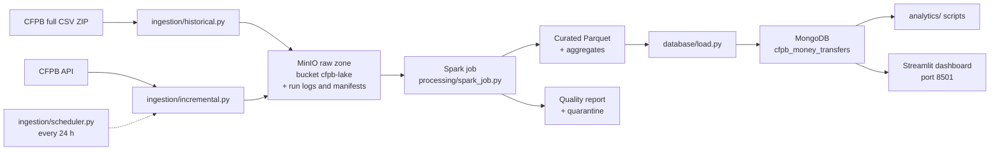

# Banking Complaints Data Platform (CFPB) - Money Transfers and Digital Payments

Group 5 | Course 020IABDM2 Big Data Frameworks (Dr. Rafiqul Haque), ESIB, USJ.

A batch data platform built on the public **CFPB Consumer Complaint Database** (US Consumer Financial Protection Bureau), focused on the domain **Money Transfers and Digital Payments**: domestic and international money transfers, mobile or digital wallets and virtual currency.

The platform:

1. downloads the full historical CSV once (scripted and repeatable);
2. collects new complaints from the CFPB API every 24 hours (bounded date window, pagination, bounded retries, high-water mark);
3. keeps every raw file unchanged in **MinIO** object storage;
4. cleans, validates and deduplicates the data with **Apache Spark**, with a data-quality gate and a quarantine zone;
5. loads curated records and aggregates into **MongoDB** (the serving layer);
6. answers five analytical questions with reproducible scripts;
7. shows the results in a **Streamlit** dashboard that reads MongoDB only;
8. starts with one Docker Compose command (`make up`).

The analysis is descriptive and diagnostic only. CFPB complaints are not a random sample of consumers, so the results describe complaints, not the whole market.

## Contents

- [Architecture](#architecture)
- [Prerequisites](#prerequisites)
- [Setup (first time)](#setup-first-time)
- [Commands](#commands)
- [Docker services](#docker-services)
- [Project status](#project-status)
- [Folder structure](#folder-structure)
- [Team and roles](#team-and-roles)
- [Troubleshooting](#troubleshooting)
- [Documentation](#documentation)

## Architecture



The layers follow the Conceptual Big Data Framework from the course: collection, storage, processing, serving, analytics and visualisation. The full architecture document, with the reason for every component, is [docs/architecture.md](docs/architecture.md) (Loutchiana Marie); the diagram image goes in `docs/images/architecture.png`.

## Prerequisites

| What | Windows | macOS |
|---|---|---|
| Git | https://git-scm.com/download/win | `xcode-select --install` (includes Git) |
| Docker engine | **Docker Desktop** with WSL 2 (run `wsl --install --no-distribution` in an administrator PowerShell, then restart), **or Rancher Desktop** with Preferences → Container Engine set to **dockerd (moby)** | Docker Desktop |
| make | `winget install ezwinports.make`, then close and reopen the terminal | `xcode-select --install` |
| Python | not needed: everything runs inside the containers | not needed |

- **Memory:** at least **8 GB of RAM** on the laptop; give Docker Desktop or Rancher Desktop at least **6 GB** of memory.
- **Disk:** at least **15 GB free** (images, the full CSV and the Docker volumes).
- **Time:** the first `make up` downloads the MongoDB and MinIO images and builds the pipeline image (Python 3.11, Java 17, PySpark 3.5.9): about **10 minutes** on a fast connection, and **up to about an hour** on a slow one (64 minutes measured on Thu 12 Nov 2026, mostly downloading PySpark, 318 MB, and the S3A jars). Leave it running: interrupted downloads resume automatically. Later starts take a few seconds.

## Setup (first time)

**1. Clone outside OneDrive or any synced folder.** Sync tools lock files and break Docker volume mounts. Use for example `C:\Dev\` on Windows or `~/dev/` on macOS.

Windows (PowerShell):
```powershell
New-Item -ItemType Directory -Force C:\Dev
cd C:\Dev
git clone https://github.com/Joseph-Nasr-USJ/cfpb-money-transfers-platform.git
cd cfpb-money-transfers-platform
```

macOS:
```bash
mkdir -p ~/dev && cd ~/dev
git clone https://github.com/Joseph-Nasr-USJ/cfpb-money-transfers-platform.git
cd cfpb-money-transfers-platform
```

**2. Set your Git identity for this repository only** (no `--global`), with the email of the GitHub account you use for university:
```
git config user.name "Your Name"
git config user.email "<your GitHub email>"
```

**3. Create your `.env` file** from the example.

Windows (PowerShell): `Copy-Item .env.example .env`
macOS: `cp .env.example .env`

Open `.env` and replace the two placeholders:

- `MINIO_ROOT_USER`: at least **3 characters**.
- `MINIO_ROOT_PASSWORD`: at least **8 characters, letters and digits only**. `$`, `#`, quotes and `=` break the file.

Keep every other value as it is. `.env` holds secrets and is never committed (it is in `.gitignore`); `.env.example` contains placeholders only.

**4. Start the stack:**
```
make up
```
Check that the services are in the expected state:
```
docker compose ps -a
```
Expected: `minio` and `mongo` are `running (healthy)`, and `minio-init` has `exited (0)` after creating the bucket. The state of `pipeline` is explained in [Project status](#project-status).

**5. Open the MinIO console** at http://localhost:9001 and log in with the `MINIO_ROOT_USER` and `MINIO_ROOT_PASSWORD` from your `.env`. The bucket **`cfpb-lake`** must be listed.

**6. Run the tests:**
```
make test
```
Expected: a summary line ending in `passed` with no failures (`26 passed` on Thu 12 Nov 2026; the number grows as components are merged).

**7. See every command:** run `make` with no argument.

To look at MongoDB from your laptop (for example with MongoDB Compass), connect to `mongodb://localhost:27017`. Inside the containers the code uses `mongodb://mongo:27017` and `http://minio:9000`, exactly as written in `.env`.

## Commands

Run every command from the repository root. Commands that run Python start a temporary `pipeline` container (`docker compose run --rm pipeline ...`), so nothing needs to be installed on the laptop.

| Command | What it does |
|---|---|
| `make` | Lists the available commands. |
| `make up` | Builds the images if needed and starts the stack in the background. |
| `make down` | Stops the stack. Data in MinIO and MongoDB is kept. |
| `make reset` | Stops the stack **and deletes the MinIO and MongoDB volumes (all data)**. Use it only to start again from zero. |
| `make logs` | Follows the logs of every service (last 100 lines, then live). Ctrl+C to quit. |
| `make test` | Runs the whole test suite (pytest) inside the pipeline container. |
| `make ingest-full` | Downloads the full CFPB CSV ZIP into the MinIO raw zone with its manifest; prints the `run_id`. |
| `make ingest-incremental` | Collects recent complaints from the CFPB API for a bounded date window; prints the `run_id`. |
| `make process SOURCE=full_load RUN_ID=<id>` | Runs the Spark job on one raw run (`SOURCE=api` for an API run). Exits with code 1 if the quality gate fails. |
| `make load RUN_ID=<id>` | Loads the curated data of one run into MongoDB with upserts (safe to repeat). |
| `make pipeline-full` | Runs the whole chain for the historical load: ingest, process, load, update the high-water mark. |
| `make pipeline-incremental` | Runs the whole incremental chain once: the same code the 24-hour scheduler runs. |
| `make sample` | Writes the development sample `data/sample/complaints_sample.csv` (about 5,000 in-domain rows). |
| `make benchmark` | Times representative MongoDB queries before and after indexing. |
| `make analytics` | Runs the analysis scripts Q1 to Q5 and saves their outputs in `analytics/output/`. |

`run_id` format: `YYYYMMDDTHHMMSSZ_<full|api>` in UTC, for example `20261110T020000Z_api`.

## Docker services

| Service | What it does | Port on your laptop |
|---|---|---|
| `minio` | Object storage for the raw, curated, quarantine and quality zones (bucket `cfpb-lake`) | 9000 (S3 API), 9001 (web console) |
| `minio-init` | One-shot job that creates the bucket `cfpb-lake`, then exits with code 0 | none |
| `mongo` | MongoDB 7.0, the serving layer (database `cfpb_money_transfers`) | 27017 |
| `pipeline` | Python 3.11 + Java 17 + PySpark 3.5.9 (Spark in local mode): collectors, Spark job, loader, 24-hour scheduler | none |
| `dashboard` | Streamlit dashboard, reads MongoDB only | 8501 |

All ports are bound to `127.0.0.1`: only your own laptop can reach them. The repository is mounted into the `pipeline` container at `/app`, so code changes do not need an image rebuild; only a change to `requirements-pipeline.txt` or the Dockerfile does (`make up` rebuilds automatically).

**Pinned versions:** every Python package is pinned with `==` in `requirements-pipeline.txt`; images are pinned to exact tags (`python:3.11-slim-bookworm`, `mongo:7.0`, `alpine/minio:RELEASE.2025-10-15T17-29-55Z`). MinIO stopped publishing official images in October 2025, so the stack uses a community rebuild of MinIO's last release (see [docs/defect_log.md](docs/defect_log.md), D-001).

## Project status

Updated Thu 12 Nov 2026. This section changes as Pull Requests are merged.

| Component | Status |
|---|---|
| Docker stack (`minio`, `minio-init`, `mongo`, `pipeline` image), Makefile | ✅ on `main` |
| Reference data: `config/state_codes.csv`, `config/product_mapping.csv` | ✅ on `main` |
| Spark explicit schemas and transforms (`processing/schema.py`, `processing/transforms.py`) with tests and fixtures | ✅ on `main` |
| Historical and incremental collectors, scheduler, sample script (`ingestion/`) | in progress (Marwa) |
| Spark job and quality gate (`processing/spark_job.py`, `processing/quality.py`) | in progress (Joseph) |
| MongoDB loader, indexes, queries, benchmark (`database/`) | in progress (Christopher) |
| Analysis scripts and dashboard (`analytics/`, `dashboard/`) | in progress (Perla) |

Expected today:

- The `pipeline` container exits with code 1 and restarts up to 5 times with `No module named ingestion.scheduler`, until the scheduler is merged. This is normal.
- The `dashboard` service is disabled (`profiles: ["dashboard"]` in `docker-compose.yml`) until `docker/dashboard.Dockerfile` exists.
- The `make` commands for ingestion, processing, loading, benchmark and analytics fail with `No module named ...` until their component is merged.

## Folder structure

```
cfpb-money-transfers-platform/
  ingestion/        historical CSV download, API collector, pipeline chain, scheduler, high-water mark, sample script
  processing/       Spark job, explicit schema, transforms, quality checks, raw profiling
  database/         MongoDB loader (upserts), indexes, aggregation queries, benchmark
  analytics/        reproducible analysis scripts Q1 to Q5; results in output/
  dashboard/        Streamlit app: app.py, pages/, components/, content/ (texts)
  tests/            ingestion/, processing/, database/, dashboard/, e2e/, fixtures/
  config/           product_mapping.csv (domain definition), state_codes.csv, settings.yaml
  docs/             architecture, runbook, data dictionary, test plan, defect log, demo script,
                    findings, metrics, MongoDB model, API notes, report/, evidence/, contributions/
  docker/           pipeline.Dockerfile, dashboard.Dockerfile, minio_init.py
  data/sample/      small development sample only (the full dataset is never committed)
  docker-compose.yml  Makefile  .env.example  requirements-pipeline.txt  README.md
```

Every folder has its own `README.md` naming its owner.

## Team and roles

| Member | Role | Owns |
|---|---|---|
| Marwa Zeineddine | Data acquisition lead | `ingestion/`, `tests/ingestion/`, sampling script, `docs/api_notes.md` |
| Joseph Nasr | Data engineering lead and repository integrator | repository setup, Docker files, `requirements-pipeline.txt`, `Makefile`, `processing/`, `config/`, `tests/processing/` |
| Christopher Al Hassrouty | Database lead | `database/`, `tests/database/`, `docs/mongodb_model.md` |
| Perla Boustany | Analytics lead and visualisation | `analytics/`, `dashboard/` code, `docker/dashboard.Dockerfile`, `tests/dashboard/`, `docs/metrics.md`, `docs/findings.md` |
| Loutchiana Marie | Delivery lead: report, architecture and data documentation, dashboard content, presentation | `docs/report/`, `docs/architecture.md`, `docs/data_dictionary.md`, `dashboard/content/`, `docs/checkpoints/`, slides |
| Charbel Mazraani | Delivery lead: README, runbook, testing evidence, demo, presentation | `README.md`, `docs/runbook.md`, `docs/test_plan.md`, `docs/defect_log.md`, `docs/demo_script.md`, `docs/evidence/`, slides |

The brief lists five roles; with six members, the "Visualisation and delivery lead" role is shared: visualisation by Perla, delivery by Loutchiana and Charbel.

## Troubleshooting

| Problem | Fix |
|---|---|
| `docker` cannot connect to the engine, or `npipe ... docker_engine` not found | Start Docker Desktop (or Rancher Desktop) and wait until it says it is running. With Docker Desktop also run `docker context use desktop-linux`. |
| `make` is not recognised (`make : The term 'make' is not recognized` or `command not found`) | Install make (see [Prerequisites](#prerequisites)), then open a **new** terminal: the installer changes `PATH` only for terminals opened afterwards. In VS Code, close and reopen VS Code itself. |
| `env file ... .env not found` | Copy `.env.example` to `.env` and set the MinIO values (setup step 3). |
| MinIO keeps restarting | `MINIO_ROOT_PASSWORD` is shorter than 8 characters. |
| `InvalidAccessKeyId` or `SignatureDoesNotMatch` after changing the MinIO password | MinIO keeps the first credentials in its volume. Put the old values back in `.env`, or run `make reset` (deletes all MinIO and MongoDB data) and then `make up`. |
| `port is already allocated` (9000, 9001 or 27017) | Another program uses the port, for example a local MongoDB service. Stop it, then `make up` again. |
| `pull access denied for cfpb-pipeline` during `make up` | Only a warning: Compose builds this image locally right after. |
| First build seems stuck on the `pip install` or `curl` step for many minutes | Normal on a slow connection: PySpark (318 MB) and the S3A jars are downloading. Leave it running (see the build time in [Prerequisites](#prerequisites)). |
| First build fails with `Read timed out` or a hash mismatch | The connection dropped while downloading PySpark (318 MB). Run `make up` again: downloads resume where they stopped. |
| Docker runs out of memory, or Spark is killed | Give Docker Desktop or Rancher Desktop at least 6 GB of memory, then restart it. |
| Pushing gives `403 ... denied to <another account>` | Your computer used a different GitHub account. Run `git remote set-url origin https://<your-username>@github.com/Joseph-Nasr-USJ/cfpb-money-transfers-platform.git` and push again. |

More recovery steps (failed run, resume, reset of the high-water mark, index rebuild) are in the runbook.

## Documentation

| Document | Content | Owner |
|---|---|---|
| [docs/runbook.md](docs/runbook.md) | Start, stop, reset, run the loads, schedule, logs, data quality, recovery, troubleshooting (draft due Wed 18 Nov) | Charbel |
| [docs/test_plan.md](docs/test_plan.md) | Every test level, test, owner and status | Charbel |
| [docs/defect_log.md](docs/defect_log.md) | Defects found and corrected | Charbel |
| [docs/architecture.md](docs/architecture.md) | Components and the reason for each | Loutchiana |
| [docs/data_dictionary.md](docs/data_dictionary.md) | Curated fields, types and rules | Loutchiana |
| [docs/report/](docs/report/) | Technical report | Loutchiana (editor), every owner |
| [docs/metrics.md](docs/metrics.md), [docs/findings.md](docs/findings.md) | Metric definitions and analytical findings | Perla |
| [docs/mongodb_model.md](docs/mongodb_model.md) | Collections, indexes, aggregations | Christopher |
| [docs/api_notes.md](docs/api_notes.md) | CFPB API behaviour and limits | Marwa |

Official CFPB sources: [database](https://www.consumerfinance.gov/data-research/consumer-complaints/), [API](https://cfpb.github.io/api/ccdb/api.html), [fields](https://cfpb.github.io/api/ccdb/fields.html), [release notes](https://cfpb.github.io/api/ccdb/release-notes.html).
