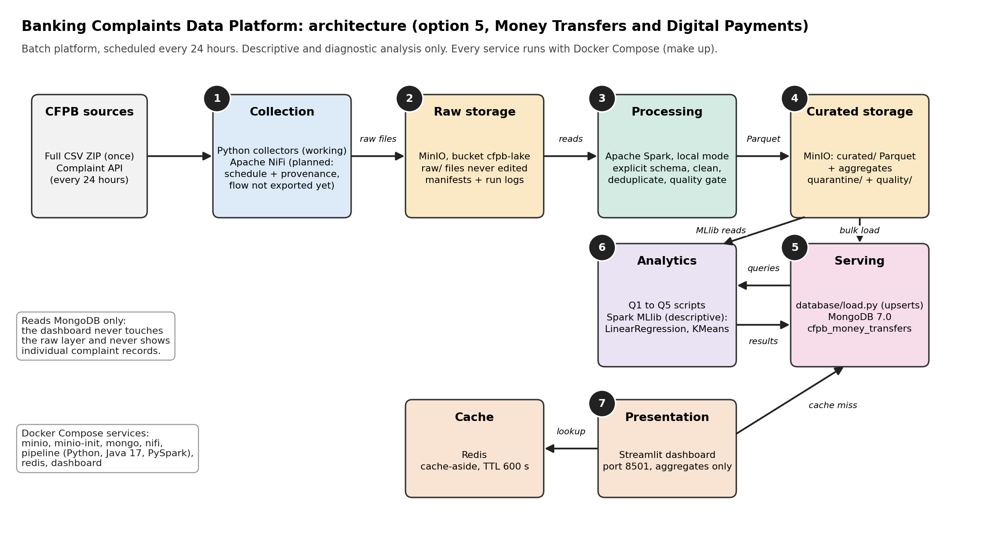
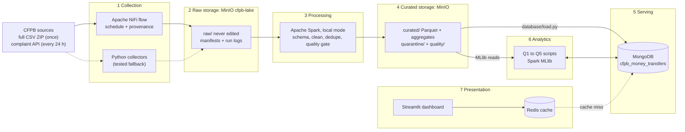

# Architecture

**Owner:** Loutchiana Marie | **Status:** written Sat 21 Nov 2026 from the code on `main` (PR #18) and the team plan; updated Mon 23 Nov 2026 after the NiFi and Redis services were merged (PR #27) and after a full run on the real CFPB file. Components still to be merged (NiFi flow, collectors, dashboard) are marked **target** in sections 6 and 12.

## 1. Purpose and scope

The platform turns the public **CFPB Consumer Complaint Database** into evidence for one financial domain, **option 5: Money Transfers and Digital Payments** (domestic and international transfers, mobile or digital wallets, virtual currency). It answers the project question of the brief: how a small team can turn public complaint records into useful evidence while making clear what those records can and cannot tell us.

Design rules taken from the brief:

- **Batch, not streaming.** The CFPB publishes complaints daily, so the platform loads the full history once and then collects updates every 24 hours. Real-time and simulated streaming are out of scope.
- **Descriptive and diagnostic analytics only** (Session 1): what happened, when, where, and how patterns differ. No prediction, no NLP, no causal claims.
- **Every component has a clear purpose.** The objective is a complete, testable and well-explained system, not the most complicated one.

## 2. Architecture diagram



The same diagram as Mermaid (GitHub renders it; the PNG is drawn by `images/make_architecture_diagram.py`):



## 3. The seven layers (Conceptual Big Data Framework, Session 2)

Session 2 chains collection, storage, processing, analytics and visualisation. Our platform splits storage and serving so that each layer has one job.

| # | Layer | Purpose | Technology | Alternative considered | Where in the repository |
|---|---|---|---|---|---|
| 1 | Collection | Download the full CSV once, then collect new complaints from the API on a schedule, with bounded windows, retries and a high-water mark | **Apache NiFi** (course tool), Python collectors as tested fallback | Kafka and Flume (streaming and log collection, out of scope), Sqoop (moves relational data) | `ingestion/`, `ingestion/nifi/` |
| 2 | Raw storage | Keep every downloaded file and API response unchanged, by ingestion date and run | **MinIO** object storage, bucket `cfpb-lake` | HDFS (needs a cluster), Ceph (heavy for one machine) | `docker/minio_init.py`, MinIO paths in section 5 |
| 3 | Processing | Validate, clean, standardise, filter to the domain, deduplicate, quarantine bad records, aggregate, report quality | **Apache Spark** (PySpark 3.5.9, DataFrames, local mode) | Pandas (does not scale to the full file), Spark Streaming (no live stream) | `processing/` |
| 4 | Curated storage | Hold the trusted, typed dataset, the dashboard aggregates, the rejected records and the quality reports | **Parquet** files in MinIO, partitioned by year and month | ORC (comparable), CSV (slow, text) | `curated/`, `quarantine/`, `quality/` in MinIO |
| 5 | Serving | Give the dashboard fast, filtered access to complaints and aggregates | **MongoDB 7.0** (document model) | Key-value, wide-column and graph stores | `database/`, `docs/mongodb_model.md` |
| 6 | Analytics | Answer Q1 to Q5 with reproducible scripts, including two descriptive machine-learning analyses | Python scripts and **Spark MLlib** (`LinearRegression`, `KMeans`) | Forecasting models (out of scope) | `analytics/` |
| 7 | Presentation | Let a policy analyst explore the results without code | **Streamlit** dashboard with a **Redis** cache | Notebooks, BI tools | `dashboard/` |

All layers run with **Docker Compose** (`make up`), which makes the platform reproducible on any machine.

## 4. End-to-end data flow

1. **Historical load (once).** The collector downloads the CFPB full CSV ZIP in chunks, stores the ZIP and the extracted CSV under `raw/cfpb/full_load/ingest_date=YYYY-MM-DD/` and writes a `manifest.json` (source URL, timestamps, size, SHA-256 checksum, record count). The file is never edited or overwritten.
2. **Incremental load (every 24 hours).** The collector asks the API for a bounded window that starts at the high-water mark minus an overlap (21 days, `OVERLAP_DAYS`), with one request series for all the product labels of the domain. It pages with `search_after` (the sort values of the last hit), because the `frm` offset was tested on 20 Nov and silently returned the same page again; a guard stops a run whose page brings no new complaint, so a broken pagination can never loop forever. Requests have a timeout and at most three retries (back-off of 2, 4 and 8 seconds, `Retry-After` respected), and the collector saves **each response unchanged** to `raw/cfpb/api/ingest_date=.../run_id=<id>/response_<page>.json` before anything is processed. A run log records the run id, window, pagination state (so a failed run can resume from its last saved page), HTTP status, retries, outcome, raw paths, record count, the API's own `_meta` freshness fields and the next high-water mark. A successful empty response is recorded as such and is different from a failed request. The CFPB firewall answers 403 to custom User-Agent headers, so the collectors send the HTTP library's default one (found and logged as a defect by Marwa).
3. **Spark job** (`processing/spark_job.py --source full_load|api --run-id <id>`). Reads the raw run with an explicit schema, maps CSV headers and API keys to the same standard column names, trims strings, parses dates, normalises Yes/No and missing values, keeps only the domain (`config/product_mapping.csv`), deduplicates by Complaint ID, derives year, month, year_month and the processing lag, splits off the quarantine, builds the quality report and applies the quality gate. If the gate fails, Spark exits with code 1 and publishes no curated data.
4. **Curated output.** Records are merged with the existing curated Parquet by Complaint ID (only the touched year and month partitions are rewritten), and the two aggregates `agg_monthly` and `agg_company_year` are rebuilt from all curated data.
5. **MongoDB load** (`python -m database.load --run-id <id>`). Upserts the complaints in batches of 5,000, replaces the aggregate collections atomically by renaming temporary collections, copies the run log and quality report into `pipeline_runs` and `quality_reports` and records the MongoDB count for the reconciliation check. A quality gate that stopped the run is rejected before MongoDB is opened.
6. **High-water mark.** It advances only after Spark and the MongoDB load have both succeeded.
7. **Analysis and dashboard.** The analysis scripts, the two Spark MLlib scripts and the dashboard read MongoDB only. The dashboard checks Redis first (cache-aside) and queries MongoDB on a cache miss.

`make pipeline-incremental` runs the same chain by hand, which the brief allows for the live demonstration because it uses the same collector and rules as the scheduled run.

**Traceability.** Every dashboard figure can be traced back: the dashboard query (`database/queries.py`) reads MongoDB; each complaint document carries `source_type`, `ingest_run_id` and `ingested_at`; the run id leads to the raw objects in MinIO, the run log, the manifest and the quality report of that run.

## 5. Storage layout (bucket `cfpb-lake`)

```
raw/cfpb/full_load/ingest_date=YYYY-MM-DD/complaints.csv.zip | complaints.csv | manifest.json
raw/cfpb/api/ingest_date=YYYY-MM-DD/run_id=<run_id>/response_<page>.json
logs/ingestion/run_id=<run_id>.json
state/high_water_mark.json
curated/complaints/option=5/year=YYYY/month=MM/        (Parquet, two-digit month)
curated/aggregates/agg_monthly/                        (Parquet)
curated/aggregates/agg_company_year/                   (Parquet)
quarantine/run_id=<run_id>/                            (Parquet, with reject_reason)
quality/run_id=<run_id>/quality_report.json
```

`run_id` has the form `YYYYMMDDTHHMMSSZ_<full|api>` in UTC, for example `20261110T020000Z_api`. Raw is separated from curated so that the raw archive can be reprocessed with different rules without downloading again, and so that the scope used for analysis (our domain) stays separate from the full archive, as the brief requires.

## 6. Docker services

| Service | Role | Port on the laptop |
|---|---|---|
| `minio` | Object storage for the raw, curated, quarantine and quality zones | 9000 (S3 API), 9001 (web console) |
| `minio-init` | One-shot job that creates the bucket `cfpb-lake`, then exits with code 0 | none |
| `mongo` | MongoDB 7.0, the serving layer | 27017 |
| `nifi` | Apache NiFi: scheduled collection into MinIO, web UI, provenance of every run (service on `main` since PR #27; the exported flow is still **target**) | 8443 (HTTPS, 127.0.0.1) |
| `pipeline` | One image with Python 3.11, Java 17 and PySpark 3.5.9: Spark in local mode, the loader, the processing chain and the Python fallback collectors | none |
| `redis` | Cache for dashboard queries; in memory only, 256 MB, least recently used keys removed first (service on `main` since PR #27) | 6379 (127.0.0.1) |
| `dashboard` | Streamlit, reads MongoDB only | 8501 |

All ports are bound to `127.0.0.1`, so the stack is reachable only from the local machine. Images and Python packages are pinned (for example `python:3.11-slim-bookworm`, `mongo:7.0`, every package in `requirements-pipeline.txt` with `==`). Secrets live in `.env`, which is never committed; `.env.example` holds placeholders only.

**MinIO image.** MinIO stopped publishing official Docker images in October 2025 and the official `minio/minio` image can no longer be pulled ("pull access denied", tested 10 Nov 2026). We use `alpine/minio:RELEASE.2025-10-15T17-29-55Z` (digest `sha256:cf23643a6cf9ce159c57643ceb88279e431262282428c9e0bf3a7ef1a97e84b4`), a community rebuild of MinIO's last release, pinned to that exact tag. MinIO ports are bound to 127.0.0.1 so the service is only reachable from the local machine, and the container runs as root because the image's default user cannot write to the Docker volume. The professor was informed. (Defects D-001 and D-002 in [defect_log.md](defect_log.md).)

**Base image.** `python:3.11-slim-bookworm` (Debian 12), because Debian 13 no longer ships Java 17 and Spark 3.5 does not support Java 21.

## 7. Technology choices and the alternatives considered

**Collection: Apache NiFi, with a Python fallback (Session 2).** NiFi is an industry-standard tool for directed graphs of routing and transformation, with a scheduler and a **provenance repository** that records every run. It fits the need exactly: `InvokeHTTP` fetches the CSV ZIP and the API pages, `PutS3Object` writes them into MinIO, `CryptographicHashContent` computes the checksum, and a CRON schedule starts the flow every 24 hours. The lecturer prefers course tools, and the brief allows NiFi or Python. Kafka (publish and subscribe streams) and Flume (log collection) serve streaming and log collection, which the brief rules out; Sqoop moves data between relational databases and HDFS, and Session 2 notes its weak failure handling (partial imports, no pause and resume). Our collector is designed against those weaknesses: saved pagination state, bounded retries, explicit run outcomes and idempotent reruns. The tested Python collector stays as the fallback and uses the same raw paths and run logs.

**Raw storage: MinIO (Session 3.1).** Raw files are whole objects (a ZIP, a CSV, JSON pages) that are written once and read in bulk, which is the object-storage role. HDFS and Ceph need a cluster and add operations without a benefit at about 200,000 records. MinIO speaks the S3 protocol, so Spark reads and writes it through the S3A connector (`s3a://cfpb-lake/...`). The ZIP uses file-level compression and is generally not splittable, so we keep the original ZIP for preservation and also store the extracted CSV for processing.

**Processing: Spark DataFrames in local mode (Session 4.1).** Spark is in-memory processing that extends MapReduce; its data is split into partitions and its transformations are lazy and recomputed at every action, so the job **caches** the curated DataFrame that the quality checks and both aggregates reuse. We use Spark SQL DataFrames (named columns, optimised plans) rather than raw RDDs. In local mode the driver and the executors run inside the `pipeline` container; on a real cluster the same code would run on a master and workers. Spark Streaming works in micro-batches; we use a scheduled batch every 24 hours instead, because there is no live stream to consume.

**Curated storage: Parquet (Session 3.1).** Parquet is columnar, stores its schema in the file footer, compresses well and lets a reader fetch only the needed columns, which is what the aggregates and the analysis do. CSV is simple but slow, and compressed text cannot be split. ORC is the comparable columnar alternative with statistics and lightweight indexes; we chose Parquet for its wide tool support. Partitioning by year and month lets Spark and the loader read only the affected partitions.

**Serving: MongoDB, document model (Session 4.1).** The dashboard reads complaint-shaped records filtered on several fields at once (product, date, state, company, issue). A key-value store cannot filter like that; wide-column and graph models do not match these queries. Each complaint is one self-contained document (a bounded `tags` array and a `lineage` sub-document are embedded) because data read together is stored together; the aggregates, run logs and quality reports are separate collections because they have their own lifecycle. `complaint_id` is `_id`, which enforces uniqueness; dates are native BSON `Date` values so range filters, grouping and date indexes work correctly (strings would compare lexically and break across formats). Compound indexes put the equality field first and the date last (`{sub_product_std, date_received}`, `{issue, ...}`, `{state, ...}`, `{company, ...}`, `{submitted_via, ...}`), and every aggregation starts with `$match` so the indexes are used. Every index costs storage and slows writes, so only the dashboard filters are indexed.

**CAP position.** During a network partition a distributed system must choose consistency or availability. Our deployment is a **single MongoDB node**, so no partition can occur. In production, a replica set with majority writes and reads from the primary would favour consistency.

**Cache: Redis (Session 4.1).** Redis is an in-memory data-structure server used for caches, sessions and counters; the slides place caches among its best uses. We use it **cache-aside**: the key is the query name plus the filters, the value is the query result, and the time-to-live is 600 seconds (`CACHE_TTL_SECONDS`), so repeated dashboard views do not re-run the same MongoDB aggregation. The freshness rule is therefore stated on the dashboard: results are at most 10 minutes old.

**Machine learning: Spark MLlib (Session 4.1).** The slides list machine learning among Spark's main features, next to Spark SQL and Spark Streaming; MLlib is Spark's machine-learning library. `LinearRegression` fits the trend of each issue's monthly share to identify emerging issues; `KMeans` with a silhouette score groups states by complaint profile. Both describe past data, with rules fixed in advance (an issue is "emerging" at a slope of at least +0.2 points per month, R² of at least 0.5 and at least 50 complaints in the window). They do not forecast: the brief keeps predictive modelling out of scope. The results are written to MongoDB, so the dashboard still reads MongoDB only.

**Presentation: Streamlit.** The brief recommends it; it builds the filters, charts and limitation notes in Python without a separate front end.

## 8. Design trade-offs

| Decision | Why | What we give up |
|---|---|---|
| Batch every 24 hours, not streaming | The CFPB publishes daily; the brief rules streaming out; batch is simple to test and replay | Data is up to a day old |
| MongoDB as serving store, not the Parquet files | Fast filtered access and aggregation for the dashboard; indexes; upserts | A second copy of the data to keep in sync (reconciled on every load) |
| MinIO for the raw zone | Original files kept unchanged, reprocessable, S3-compatible | Single node, no replication |
| Spark in local mode | Same code as a cluster, but runs on a laptop in one container | No horizontal scale (not needed at about 200,000 records) |
| Separate raw, curated and serving layers | Each layer has one purpose; a mistake in processing never destroys the source | More storage and more steps |
| Python fallback next to NiFi | NiFi is the course tool and gives provenance; the tested Python collector guarantees the demo cannot depend on one tool | Two implementations to keep consistent (same paths and run log) |
| Quality gate that stops the run | Bad data never reaches MongoDB silently | A failed run needs attention (the quarantine and report show why) |

## 9. Reliability and data quality by design

- **Idempotent reruns.** Deduplication by Complaint ID in Spark with a documented tie-break (latest `ingested_at` wins; then `api` over `full_load`; then a record whose response is not "In progress"; then the latest `date_sent_to_company`; then a stable hash) and upserts in MongoDB mean that running the same window twice does not change the curated count or the dashboard measures.
- **Overlap.** The collector uses `date_received`. The window overlaps the previous one by 21 days because the CFPB publishes a complaint only after the company responds or after 15 days, so complaints appear late. An overlap recovers recent late arrivals but can miss revisions to much older records; those are reconciled by re-running the full CSV load, where the Spark merge keeps the latest ingestion.
- **Six quality dimensions** with thresholds fixed in advance: uniqueness (0 problems), completeness (required fields at least 99.5% filled), validity (warn above 0.5% invalid, fail above 2%), consistency (unmapped combinations listed), freshness (latest record at most 3 days old) and reconciliation (raw = curated + quarantined + out of domain + duplicates removed, exactly). Failures that **stop** a run: uniqueness, required completeness, validity above 2% and reconciliation. Everything else only **warns**.
- **Quarantine.** Records with a missing ID, an invalid date, a negative processing lag or an invalid state go to `quarantine/` with their reasons; they are counted, never silently dropped.
- **Known bad records** are part of the tests (defect D-005): the quality gate is shown to catch an invalid date, an invalid state, a negative interval and a missing ID.

## 10. Security and configuration

Secrets are never in code: they are read from `.env` (placeholders in `.env.example`). Every port is bound to `127.0.0.1`. The CFPB data is public and the platform never displays individual complaint records. The MinIO container runs as root, which is acceptable only because the stack is local; a production deployment would use a dedicated user, TLS and a secrets manager.

## 11. Limits of this architecture and next improvements

- **Single-node MongoDB and MinIO.** If a volume is lost, recovery means rerunning the idempotent pipeline. The improvement to prioritise is a **MongoDB replica set** (automatic primary election, majority writes, reads from the primary). Sharding is not needed at about 200,000 documents; a future shard key would be a hashed `_id` or `{sub_product_std, date_received}`.
- **Spark local mode** does not scale out; a cluster would be needed for much larger data.
- **Batch latency** of up to 24 hours is accepted by design.
- The data is **not a random sample** (Session 1, inferential analytics), so the platform describes complaints in this database and does not generalise to all consumers.

## 12. Implementation status and known gaps (Mon 23 Nov 2026)

| Item | State |
|---|---|
| Docker stack (`minio`, `minio-init`, `mongo`, `pipeline` image), Makefile, reference files | on `main` |
| Spark schema, transforms, quality gate, Spark job; MongoDB loader, indexes, queries, benchmark | on `main` (42 tests passed on 21 Nov in Charbel's run; 57 passed on 22 Nov with `make test` on my machine) |
| Metric definitions, README, runbook, test plan, defect log, demo script | on `main` |
| Python collectors (historical, incremental), sample script, API notes and their tests | written, on branch `marwa/historical-load`, not merged yet (Marwa); the scheduler and the pipeline chain are still to come |
| `nifi` and `redis` services, `.env` settings, `make ml` target | on `main` (Joseph, PR #27, merged 22 Nov) |
| NiFi flow (exported to `ingestion/nifi/`) | in progress (Marwa, Joseph) |
| Analysis scripts, Spark MLlib scripts, dashboard | in progress (Perla) |

Two differences between the contract and the code on `main` that the team still has to close (to confirm with Joseph and Christopher):

1. The Spark job and the MongoDB loader both use `curated/complaints/domain=money_transfers_payments/` (checked in the code and by the full run below), while the brief's example path is `curated/complaints/option=5/`. The two components agree with each other; the difference is only with the example in the brief, so the team can keep `domain=` and say so, or change writer and loader together.
2. `processing/quality.py` still names two dimensions `timeliness` and `integrity`; brief V2 names them **freshness** and **reconciliation**, and the documents use the V2 names.

## 13. References

- Course sessions of Dr. Rafiqul Haque: Session 1 (analytics types, inferential analytics), Session 2 (Conceptual Big Data Framework, collection tools), Session 3.1 (storage tools and formats), Session 4.1 (NoSQL, MongoDB, Redis, Spark).
- Brief V2: "Public Banking Complaints Data Platform", 020IABDM2.
- CFPB: [Consumer Complaint Database](https://www.consumerfinance.gov/data-research/consumer-complaints/), [API](https://cfpb.github.io/api/ccdb/api.html), [fields](https://cfpb.github.io/api/ccdb/fields.html), [release notes](https://cfpb.github.io/api/ccdb/release-notes.html).
- Team documents: [mongodb_model.md](mongodb_model.md), [metrics.md](metrics.md), [runbook.md](runbook.md), [test_plan.md](test_plan.md), [defect_log.md](defect_log.md).

### Result of a full run on the real file (Sun 22 Nov 2026)

One run of the chain with the historical collector, the Spark job and the loader, on the official CFPB file of 22 November 2026 (run `20261122T183046Z_full`, Docker with 8 GB):

| Step | Result |
|---|---|
| Collection | `complaints.csv.zip` 353.6 MiB, extracted CSV 5.5 GiB, 19,371,701 records, SHA-256 and manifest saved next to the raw files |
| Spark job | quality gate passed (PASS); 19,166,525 out of domain + 112 quarantined (32 invalid state, 80 sent before received) + 205,064 curated + 0 duplicates removed = 19,371,701 |
| MongoDB load | 205,064 unique complaints, 73,545 monthly summaries, 8,074 company-year summaries; latest complaint 20 Nov 2026, so the ingestion lag is 2 days |
| Indexes | the five compound indexes on `complaints` and the monthly index; a query on state and date uses `state_date_idx` (index scan) |

The count of 205,064 is higher than the 199,152 of the API test of 20 November because the two numbers count different things. The API figure counts the current product label only. On 22 November the current label has 199,354 records in the file, which is 202 more than on 20 November (complaints published since). The curated data also keeps the legacy labels that the product mapping includes: 5,274 under "Money transfers", 418 under "Prepaid card" (mobile wallet only) and 18 under "Virtual currency"; 199,354 + 5,710 = 205,064.

Screenshots: `docs/images/minio_raw_full_load.png`, `minio_curated_parquet.png`, `minio_quality_report.png`, `minio_bucket_overview.png` and `mongodb_collections_indexes.png` (output of `mongosh`, not Compass).
