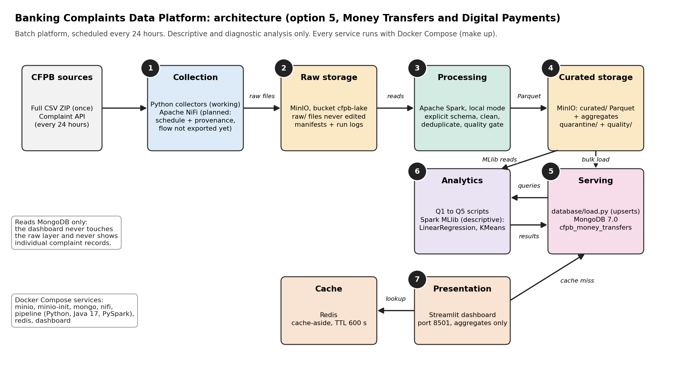

<!--
Section 4.1 Architecture and technology choices
Owner: Loutchiana | Target: 300 words | Written: Sat 21 Nov
Summary of docs/architecture.md (the full reasoning is there). Facts to confirm before submission: that the NiFi flow is exported and
running (the NiFi and Redis services were merged on 22 Nov, PR #27), and the curated path (option=5, merged in PR #31).
-->

### 4.1 Architecture and technology choices

The platform is a batch system of seven layers, following the Conceptual Big Data Framework of Session 2. Each layer has one purpose and the whole stack starts with one Docker Compose command.

**Collection.** Apache NiFi is planned to start the collection every 24 hours and keep the provenance of every run (its service is in the Docker stack; its flow is still to be exported); the tested Python collector is the working path. NiFi was chosen from the course's ingestion tools for scheduling and provenance; Kafka and Flume serve streaming and log collection, which the brief rules out, and Sqoop moves relational data.

**Raw storage.** MinIO object storage keeps every file unchanged, by ingestion date and run, with manifests and run logs. HDFS and Ceph need a cluster that about 200,000 records do not justify.

**Processing.** Spark DataFrames in local mode validate, clean, deduplicate and aggregate. A quality gate stops a failing run.

**Curated storage.** Parquet is columnar, compressed and stores its schema, so the aggregates read only the columns they need. ORC would be an equivalent alternative; CSV is slower and compressed text cannot be split.

**Serving.** MongoDB's document model fits complaint-shaped records filtered on several fields; key-value, wide-column and graph stores do not. The single node has no network partition, so the CAP choice does not arise; a replica set is the first improvement.

**Analytics.** Spark MLlib describes the data with linear regression (emerging issues) and K-means (groups of states). It does not forecast, because the brief keeps predictive modelling out of scope.

**Presentation.** Streamlit reads MongoDB only, with Redis as a cache-aside layer with a ten-minute time-to-live.

**Trade-offs.** We accept data that is up to a day old, a single node and no horizontal scale, in return for a platform that is simple to test, replay and reproduce.
