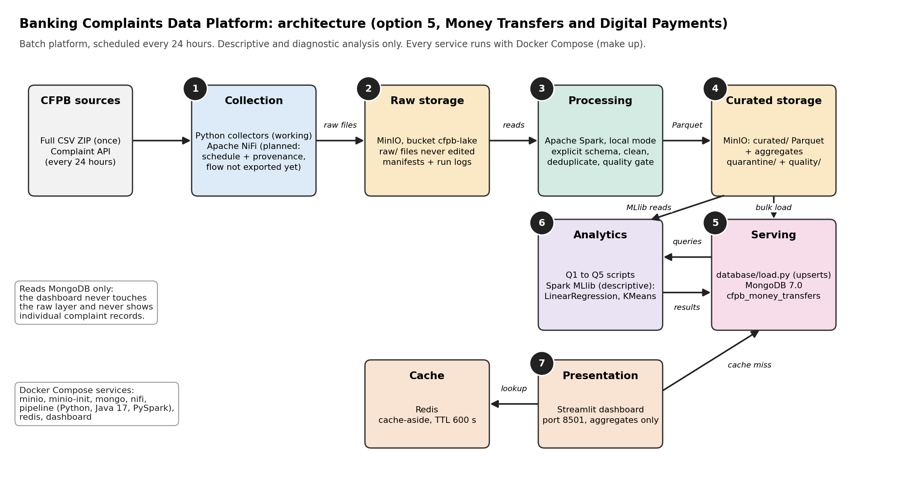

# Banking Complaints Data Platform: Money Transfers and Digital Payments

Technical report. Group 5, course 020IABDM2 Big Data Frameworks (Dr. Rafiqul Haque), ESIB, USJ. Marwa Zeineddine, Perla Boustany, Joseph Nasr, Christopher Al Hassrouty, Charbel Mazraani, Loutchiana Marie.

## 1. Executive summary

_Draft pending (Loutchiana, due Fri 27 Nov)._

## 2. Problem and scope

**Problem.** A public-interest organisation that monitors consumer financial complaints needs a dependable way to collect the records the CFPB publishes, check their quality and show what they say to people who do not write code. Our platform turns the CFPB Consumer Complaint Database into evidence for one financial domain and states what the records cannot tell us. The analysis is descriptive and diagnostic (Session 1); it does not predict.

**Intended users.** Policy analysts in payments oversight (which issues and sub-products are growing), service and operations managers (channels, response categories, timely-response rates) and the platform maintainer (run logs, quality reports, freshness).

**Chosen option.** Option 5, money transfers and digital payments: emerging issues, shifts in submission channels and growth rates.

**Filters.** The domain is defined by `config/product_mapping.csv`; original source labels are kept next to our standard categories.

| Source product | Sub-products kept | Standard category |
|---|---|---|
| Money transfer, virtual currency, or money service | all | same label |
| Money transfers (label used before 2017) | all | Money transfer, virtual currency, or money service |
| Virtual currency (legacy label) | all | Virtual currency |
| Prepaid card | Mobile wallet only | Mobile or digital wallet |

Four core sub-products are compared throughout: domestic (US) money transfer, international money transfer, mobile or digital wallet and virtual currency; the rest are grouped as "Other money services". The CFPB API returned 199,152 records for the current label on 20 November 2026.

**Reporting period.** The full history in the CFPB file, kept current by a 24-hour incremental collection. Each question's window is fixed in advance, and the current year is labelled partial.

**Analytical questions.**

| # | Question | Window |
|---|---|---|
| Q1 (demo) | Which sub-products and issues grew fastest, and how did the mobile or digital wallet share change? | 2021 to 2025 |
| Q2 (demo) | How did the "Fraud or scam" share change across the four core sub-products? | since 2018 |
| Q3 | Has the mix of submission channels changed over time? | full history |
| Q4 | How do response categories and timely-response rates differ by sub-product and among the largest companies by share? | full history |
| Q5 | Which states show different issue profiles (optionally per 100,000 residents)? | full history |

Q1 and Q5 use Spark MLlib descriptively (issue-share trends, K-means groups of states). Every answer shows raw counts and percentages within each group, with its caution next to it.

## 3. Data source and limitations

_Draft pending (Loutchiana (category changes with Joseph), due Sun 22 Nov)._

## 4. Architecture and implementation

### 4.1 Architecture and technology choices

The platform is a batch system of seven layers, following the Conceptual Big Data Framework of Session 2. Each layer has one purpose and the whole stack starts with one Docker Compose command.

**Collection.** Apache NiFi starts the collection every 24 hours and keeps the provenance of every run; a tested Python collector is the fallback. NiFi was chosen from the course's ingestion tools for its scheduling and provenance. Kafka and Flume serve streaming and log collection, which the brief rules out, and Sqoop moves relational data.

**Raw storage.** MinIO object storage keeps every file unchanged, by ingestion date and run, with manifests and run logs. HDFS and Ceph need a cluster that about 200,000 records do not justify.

**Processing.** Spark DataFrames in local mode validate, clean, deduplicate and aggregate. A quality gate stops a failing run. Spark Streaming is not used because the CFPB publishes daily, so there is no live stream.

**Curated storage.** Parquet is columnar, compressed and stores its schema, so the aggregates read only the columns they need. ORC would be an equivalent alternative; CSV is slower and compressed text cannot be split.

**Serving.** MongoDB's document model fits complaint-shaped records filtered on several fields; key-value, wide-column and graph stores do not. The single node has no network partition, so the CAP choice does not arise; a replica set is the first improvement.

**Analytics.** Spark MLlib describes the data with linear regression (emerging issues) and K-means (groups of states). It does not forecast, because the brief keeps predictive modelling out of scope.

**Presentation.** Streamlit reads MongoDB only, with Redis as a cache-aside layer with a ten-minute time-to-live.

**Trade-offs.** We accept data that is up to a day old, a single node and no horizontal scale, in return for a platform that is simple to test, replay and reproduce. MinIO no longer publishes official Docker images, so we pin a community rebuild of its last release to an exact tag.

### 4.2. Collection, scheduling and raw storage

_Draft pending (Marwa, due Wed 25 Nov)._

### 4.3. Spark processing

_Draft pending (Joseph, due Wed 25 Nov)._

### 4.4. MongoDB serving layer

_Draft pending (Christopher, due Wed 25 Nov)._

### 4.5. Dashboard

_Draft pending (Perla, due Wed 25 Nov)._

## 5. Testing and operations

### 5.1. Quality thresholds, reconciliation and rerun evidence

_Draft pending (Joseph, due Wed 25 Nov)._

### 5.2. Index measurements

_Draft pending (Christopher, due Wed 25 Nov)._

### 5.3. Tests, deployment and recovery

_Draft pending (Charbel, due Wed 25 Nov)._

## 6. Findings

_Draft pending (Perla, due Wed 25 Nov)._

## 7. Reflection and next steps

_Draft pending (Loutchiana (with Charbel), due Wed 25 Nov)._

## 8. References and appendices

_Draft pending (Loutchiana (from every owner), due Fri 27 Nov)._
